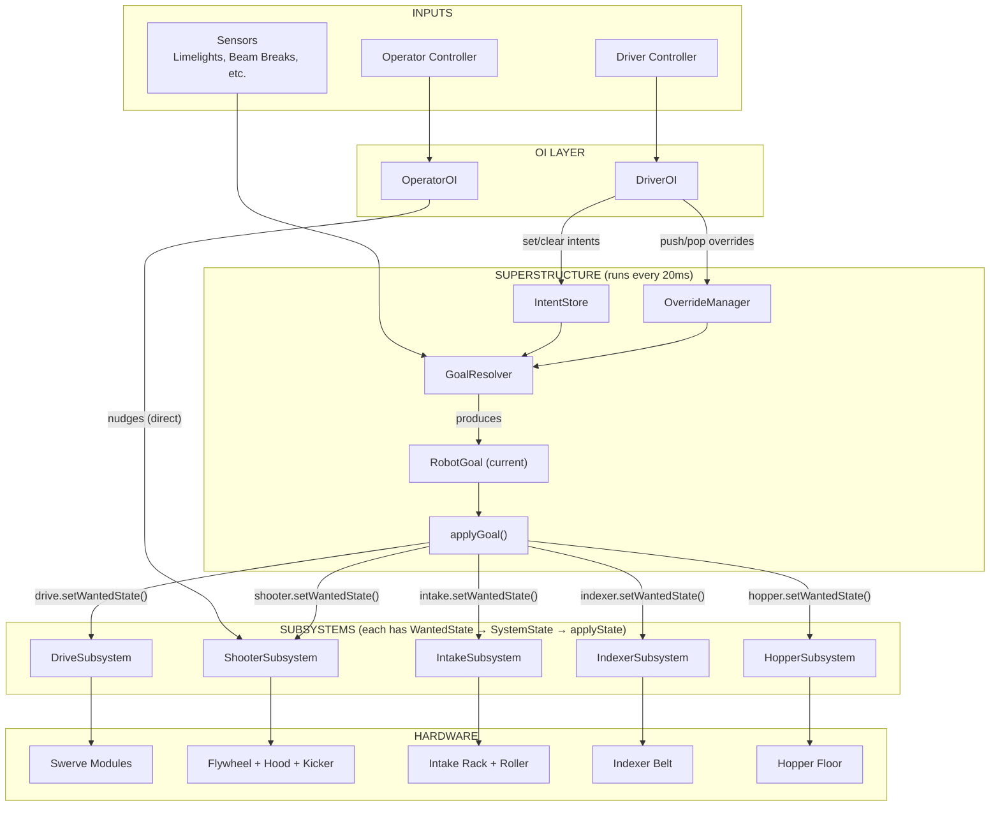
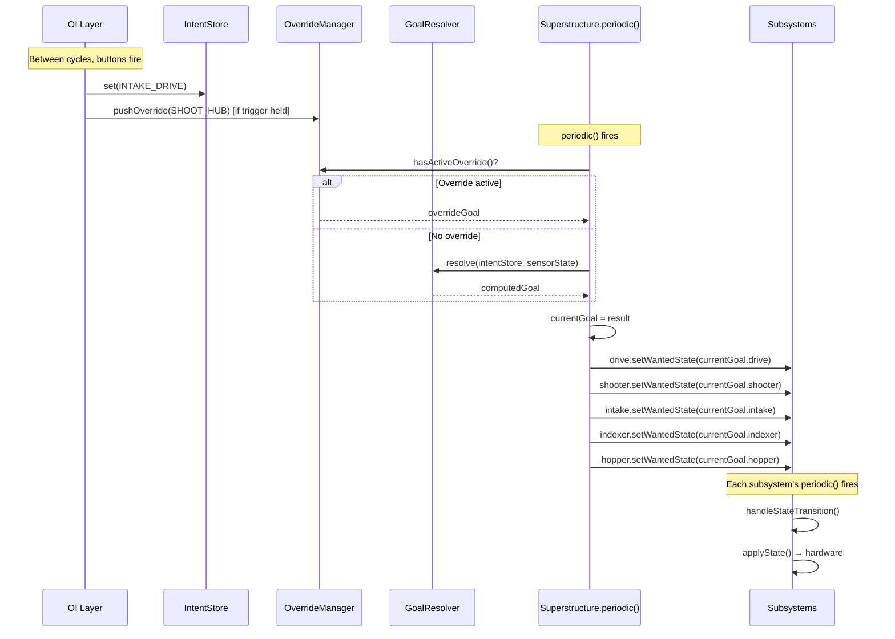
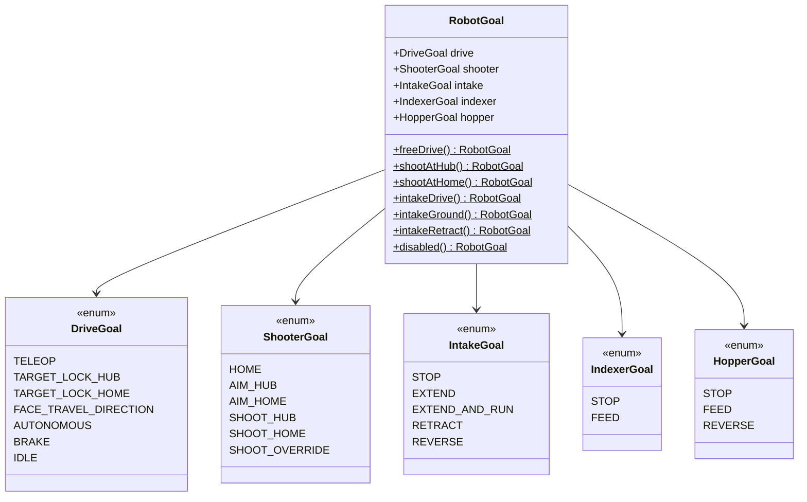
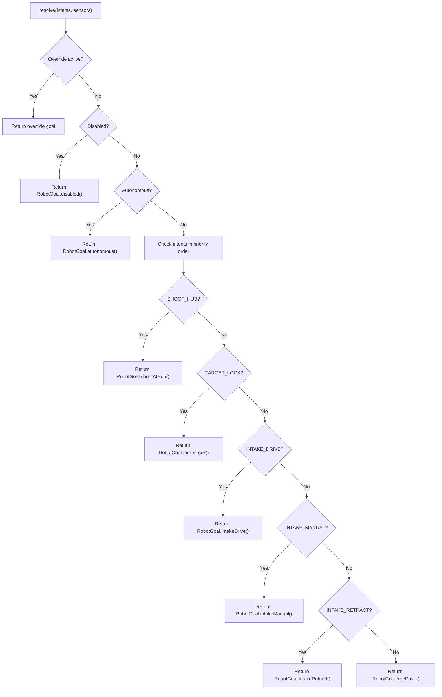
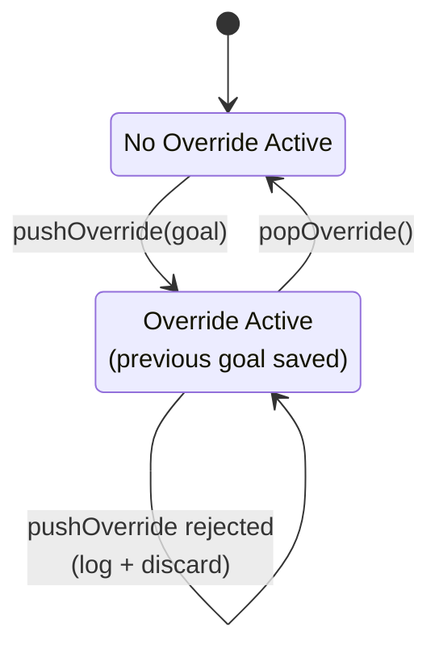
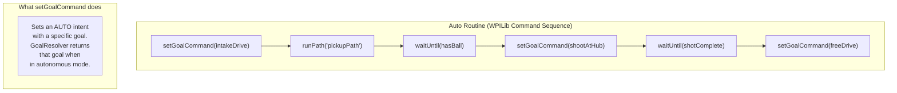
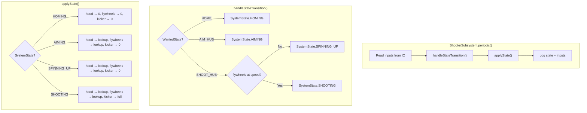
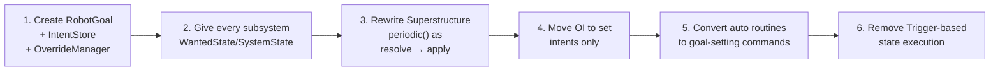

# Refactor Sketch: Goal-Based Superstructure

## Package Layout

```
frc.robot/
├── Robot.java
├── RobotContainer.java                  # Creates subsystems, wires OI
│
├── oi/
│   ├── BaseOI.java
│   ├── DriverOI.java                    # Sets intents on the IntentStore
│   └── OperatorOI.java                  # Direct nudges stay here
│
├── superstructure/
│   ├── Superstructure.java              # The periodic loop: resolve → apply
│   ├── RobotGoal.java                   # Record: what every subsystem should do
│   ├── IntentStore.java                 # Clean intent flag management
│   ├── OverrideManager.java             # Push/pop override goals
│   └── GoalResolver.java               # Transition logic: intents + sensors → goal
│
├── subsystems/
│   ├── drive/
│   │   ├── DriveSubsystem.java          # WantedState/SystemState machine
│   │   ├── DriveIO.java
│   │   └── DriveIOReal.java
│   ├── shooter/
│   │   ├── ShooterSubsystem.java        # WantedState/SystemState machine
│   │   ├── ShooterIO.java
│   │   └── ShooterIOReal.java
│   ├── intake/
│   │   ├── IntakeSubsystem.java         # WantedState/SystemState machine
│   │   ├── IntakeIO.java
│   │   └── IntakeIOReal.java
│   ├── indexer/
│   │   ├── IndexerSubsystem.java        # WantedState/SystemState machine
│   │   ├── IndexerIO.java
│   │   └── IndexerIOReal.java
│   └── hopper/
│       ├── HopperSubsystem.java
│       ├── HopperIO.java
│       └── HopperIOReal.java
│
├── auto/
│   └── Autonomous.java                  # Composes goal changes + path following
│
└── vision/
    └── Limelight.java
```

---

## System Block Diagram



---

## Data Flow Per Cycle



---

## RobotGoal Structure



---

## GoalResolver Logic



---

## Override Manager



---

## How Auto Works



Auto routines are just command sequences that change which goal the Superstructure is targeting. The Superstructure still applies it every cycle - auto doesn't bypass the system.

---

## Subsystem Internal Pattern (all subsystems follow this)



The subsystem adds intelligence that the Superstructure doesn't need to know about. The Superstructure says "shoot at hub" and the shooter figures out the spin-up sequencing internally.

---

## Key Differences From Current 2928 Code

| Aspect | Current | Refactored |
|--------|---------|------------|
| State representation | `RobotState` enum (13 values) | `RobotGoal` record (composable) |
| State execution | Trigger → Command (scheduler-managed) | `applyGoal()` direct calls every cycle |
| Subsystem control | Mixed (some through SS, some direct) | ALL through Superstructure (single writer) |
| Intent storage | Mutable boolean on enum constants | Separate `IntentStore` class |
| Override handling | EnumSet + prevState field | `OverrideManager` with push/pop |
| Shooter coordination | Command composition (`alongWith`) | Subsystem handles internally via states |
| Cleanup on state exit | `finallyDo()` on commands | Natural: next cycle applies new goal |
| Auto integration | Superstructure exposes command factories | Auto sets goals; SS applies them same as teleop |

---

## Migration Path (Suggested Order)



Step 2 is the biggest lift (shooter and indexer/hopper don't have state machines today). Steps 3-4 can be done together. Step 6 is cleanup once everything else works.
