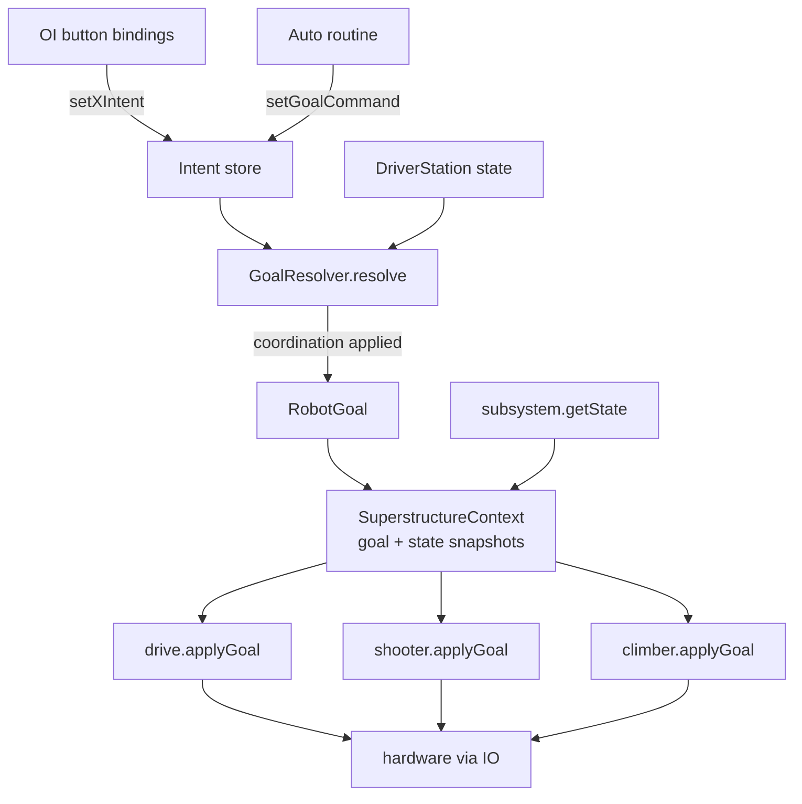

# Goal-Based Superstructure Architecture

> **Status: authoritative.** This document describes the robot-agnostic architecture
> pattern used by Team 2928's competition code. It is the starting point for any
> architecture rework on a new season's codebase. It captures *why* the pieces exist
> and *how* they fit together, using concrete snippets for clarity — but the pattern,
> not any specific subsystem, is the reusable part.
>
> **Ported from VikingRobot2024, where this architecture is actually implemented.**
> This document supersedes the earlier planning notes. Before the rework proceeds,
> retire the stale artifacts so this file is the single source of truth:
> - `REFACTOR_SKETCH.md` — an earlier sketch of this same idea; fold anything still
>   useful into this doc, then delete.
> - `ARCHITECTURE_ANALYSIS.md` — describes the *old* hybrid Superstructure + command
>   design that predates this rework; keep only as historical context or delete.
>
> Audit for any other stale architecture docs at the repo root and remove them.

---

## 1. The problem this solves

A competition robot has several subsystems (drive, shooter, intake, climber, …) that
must cooperate safely and predictably. The naive command-based approach spreads control
across dozens of command objects that each grab a subsystem and tell it what to do.
That leads to three recurring failures:

- **Conflicting authority.** Two commands want the drivetrain at once; whoever ran last
  wins. Behavior depends on scheduler timing, not intent.
- **Stale state.** A command sets a mechanism to some state, ends, and the mechanism
  keeps doing it because nothing told it otherwise.
- **Scattered coordination.** "Don't deploy the climber while the intake is out" ends up
  duplicated (or forgotten) in every command that touches either mechanism.

The goal-based superstructure fixes all three by making **one component the sole authority**
that, **every cycle**, hands **every subsystem** an explicit instruction.

---

## 2. Core principles

1. **Single authority.** One class — the `Superstructure` — is the only thing that tells
   subsystems what to do during a match. OI (operator interface) sets *intents*; auto
   routines set *intents*. Nothing calls `subsystem.setWantedState()` directly except the
   Superstructure's apply path.

2. **Goals are total.** Every cycle, every subsystem receives an explicit instruction.
   There is no "hold your current state" sentinel. If a goal doesn't mention a subsystem,
   that subsystem gets its safe default. This is what prevents stale behavior from
   accumulating across transitions.

3. **Safe defaults per subsystem.** Each subsystem has a default goal meaning "do nothing
   dangerous" (drive → driver has control, mechanisms → home/idle). The goal builder
   initializes every field to its safe default; you only specify what needs to be *active*.

4. **Subsystems own their own safety.** Each subsystem receives a read-only snapshot of
   every other subsystem's state and decides *for itself* whether it can proceed. If a
   precondition isn't met, it holds at a safe state until the condition clears. Safety is
   not something an external command has to remember to enforce.

5. **Coordination is encoded in goals.** If subsystem A needs subsystem B in a certain
   state, the goal explicitly commands B toward that state. Cooperation is declared, not
   implied.

6. **Subsystems own the "how."** The Superstructure says *what* ("shoot at the target").
   The subsystem figures out *how* (spin up → wait for speed → aim → fire). Internal
   sequencing lives inside the subsystem, never in the Superstructure.

---

## 3. The pieces

Seven collaborating types. The first four are the reusable "engine"; the last three are
the per-subsystem pattern every mechanism follows.

### 3.1 `RobotGoal` — an immutable, total description of a cycle

A record with one field per subsystem, built through a builder whose defaults are the
safe idle values. Factory methods name the meaningful whole-robot configurations.

```java
public record RobotGoal(DriveGoal drive, ShooterGoal shooter, ClimberGoal climber) {

    /** Everything unmentioned falls back to its safe default. */
    public static RobotGoal shootTarget() {
        return builder()
            .withDrive(DriveGoal.AIM_TARGET)
            .withShooter(ShooterGoal.SHOOT)
            .build();     // climber → IDLE automatically
    }

    public static Builder builder() { return new Builder(); }
    public Builder modify() { return new Builder(this); }   // derive from an existing goal

    public static class Builder {
        // Safe defaults live here — this is what makes goals "total".
        private DriveGoal   drive   = DriveGoal.TELEOP;
        private ShooterGoal shooter = ShooterGoal.HOME;
        private ClimberGoal climber = ClimberGoal.IDLE;
        // withX(...) setters return `this`; build() constructs the record.
    }
}
```

Why a record + builder rather than a big state enum: goals **compose**. `shootTarget()`
and "shoot while a path drives us" differ by one field (`.modify().withDrive(AUTONOMOUS)`),
not a new enum constant. Each subsystem's dimension varies independently.

### 3.2 Intent store + `GoalResolver` — turning inputs into a goal

Inputs arrive as *intents* — one stored value per subsystem, set by OI button bindings.
Each cycle the resolver combines stored intents with `DriverStation` state to produce the
concrete `RobotGoal`. This is also where **whole-robot coordination** lives (see §5).

```java
public RobotGoal resolve() {
    // DriverStation authority: auto mode always gives the path follower the drive.
    DriveGoal drive = DriverStation.isAutonomous() ? DriveGoal.AUTONOMOUS : driveIntent;

    // Coordination: a climber deploy forces the shooter home first.
    ShooterGoal shooter = (climberIntent == ClimberGoal.DEPLOY) ? ShooterGoal.HOME : shooterIntent;

    return RobotGoal.builder().withDrive(drive).withShooter(shooter)./*…*/.build();
}
```

The store exposes `setDriveIntent(...)`, `setShooterIntent(...)`, etc. for OI, and a
`setGoal(RobotGoal)` that overwrites all intents at once — used by auto routines.

### 3.3 `SuperstructureContext` — the read-only world snapshot

An immutable record carrying the resolved `RobotGoal` **plus** a state snapshot of every
subsystem. It is the *only* thing passed into a subsystem each cycle, and it is how one
subsystem "sees" another without holding a direct reference (which would re-introduce
scattered authority).

```java
public record SuperstructureContext(RobotGoal goal,
                                     ShooterState shooterState,
                                     ClimberState climberState) { }
```

`ShooterState` / `ClimberState` are small read-only records each subsystem publishes via
`getState()` — enough for interlocks (e.g. `shooterState.atSafeAngle()`), nothing more.

### 3.4 `Superstructure` — the periodic loop

The single authority. Its `periodic()` is the whole control cycle:

```java
@Override
public void periodic() {
    BaseStatusSignal.refreshAll(allSignals);          // 1. one batched CAN read
    RobotGoal goal = resolver.resolve();              // 2. intents + DS state → goal
    var ctx = new SuperstructureContext(goal,         // 3. goal + state snapshots
                                        shooter.getState(), climber.getState());
    drivetrain.applyGoal(ctx);                        // 4. hand every subsystem its instruction
    shooter.applyGoal(ctx);
    climber.applyGoal(ctx);
}
```

Two responsibilities beyond resolution:

- **Batched signal refresh.** Subsystems register their CTRE status signals with the
  Superstructure; it refreshes them all in *one* CAN transaction per cycle instead of each
  subsystem reading independently. See §6.
- **Auto entry point.** `setGoalCommand(RobotGoal)` returns a `runOnce` command that writes
  the goal into the resolver, so auto routines change robot behavior through the same path
  OI uses — never by touching subsystems.

### 3.5 Subsystem: the `WantedState` / `SystemState` machine

Every subsystem follows the identical shape. Two enums keep "what we were asked for"
separate from "what we're actually doing right now" (they differ during transitions):

```java
public class Climber extends SubsystemBase {
    enum WantedState { IDLE, DEPLOY, RETRACT, /* … */ }   // asked for
    enum SystemState { IDLE, DEPLOYING, RETRACTING, /* … */ }  // actually doing

    // Interlocks + translate goal → wantedState. The ONLY entry from the Superstructure.
    public void applyGoal(SuperstructureContext ctx) {
        ClimberGoal desired = ctx.goal().climber();
        if (desired == ClimberGoal.DEPLOY && !ctx.shooterState().atSafeAngle()) {
            wantedState = WantedState.IDLE;   // refuse: hold safe until precondition clears
            return;
        }
        wantedState = switch (desired) { /* map goal → wanted */ };
    }

    @Override public void periodic() {
        io.updateInputs(inputs);
        Logger.processInputs("Climber", inputs);
        systemState = handleStateTransition();  // WantedState + sensors → SystemState
        applyState();                           // SystemState → hardware, via io
    }

    public ClimberState getState() { /* read-only snapshot for the context */ }
}
```

The split matters: `handleStateTransition()` can hold in an intermediate `SystemState`
(e.g. "initializing" until a home switch trips) even though the `WantedState` never
changed. That's how a subsystem owns its own multi-step sequencing.

### 3.6 IO abstraction (AdvantageKit pattern)

Hardware is behind an interface so the subsystem logic is testable and sim-able:

- `FooIO` — interface with default no-op methods and an `@AutoLog` inputs struct.
- `FooIOReal` — the hardware implementation (TalonFX, CANcoder, …).

The subsystem picks the implementation by robot mode (`REAL` → `FooIOReal`, else the no-op
`FooIO {}`), so the same state-machine code runs on the bench, in sim, and on the robot.

### 3.7 `SignalBundle` — "declare once, use everywhere"

Registering a CAN signal for batched refresh and copying its value into the inputs struct
are two edits in two places that must stay in sync. A `SignalBundle` colocates them: it
pairs the array of signals with the closure that writes them into inputs.

```java
var hoodSignals = new SignalBundle<>(
    new BaseStatusSignal[] { hoodAngle, hoodVelocity },
    inputs -> { inputs.hoodAngle = hoodAngle.getValue();
                inputs.hoodVelocity = hoodVelocity.getValue(); });
// signals() → registration;  update(inputs) → per-cycle copy. One source of truth.
```

---

## 4. Data flow (every 20 ms)



Inside each `applyGoal → periodic`:

```
applyGoal(ctx)  → check interlocks against ctx, set WantedState
handleStateTransition()  → WantedState + sensors → SystemState
applyState()  → SystemState → hardware outputs (io)
getState()  → read-only snapshot for next cycle's context
```

---

## 5. Two levels of coordination

This is the subtlest part of the design and the easiest to get wrong. Coordination
happens at **two** distinct levels, and both are needed:

1. **Resolver-level coordination (goal shaping).** Whole-robot rules that decide *intent*.
   Example: "if the climber wants to deploy, the shooter's goal becomes HOME." This changes
   *what is asked for* before any subsystem sees the goal. It lives in `GoalResolver.resolve()`.

2. **Subsystem-level interlock (safety gate).** A subsystem refuses to act until it can
   *observe* the world is actually safe, using the state snapshots in the context. Example:
   the climber is commanded to DEPLOY but holds at IDLE until `shooterState.atSafeAngle()`
   is truly reported by the shooter's sensors. It lives in the subsystem's `applyGoal()`.

The two work as a pair: the resolver commands the shooter *toward* safety; the interlock
waits for the shooter to *reach* it before the climber moves. Neither alone is sufficient —
goal shaping expresses the plan, the interlock enforces reality.

**Keep interlocks minimal.** If a subsystem needs more than ~2–3 interlocks, the *goals*
should be redesigned to avoid the conflict rather than piling on guards.

---

## 6. Wiring and construction order

The Superstructure must be constructed **before** the subsystems, and its `periodic()`
must run **before** theirs, because it performs the batched CAN refresh the subsystems then
read. With WPILib's `CommandScheduler` calling `periodic()` in registration order, the
current code relies on constructing the Superstructure first.

```java
superstructure = new Superstructure();          // first — refreshes signals, resolves goals
drivetrain = new CommandSwerveDrivetrain();
shooter    = new Shooter();
climber    = new Climber();
superstructure.setSubsystems(drivetrain, shooter, climber);

// Each subsystem hands its CAN signals up for one batched refresh per cycle.
superstructure.registerSignals(shooter, shooter.getStatusSignals());
superstructure.registerSignals(climber, climber.getStatusSignals());
superstructure.registerSignals(drivetrain, drivetrain.getStatusSignals());
```

> **Known rough edge / future direction.** Relying on scheduler registration order is
> fragile. The intended end state is for the Superstructure to *own* subsystem construction
> and drive their `periodic()` calls explicitly, removing the ordering dependency. Design a
> rework so the Superstructure is the composition root, not just the first-registered peer.

---

## 7. OI rules

- Driver/Operator OI set **intents** and push/pop overrides on the Superstructure. They
  never reference subsystems to command them.
- Read-only queries from OI (e.g. an LED reflecting a lock state) are fine.
- **One deliberate exception:** operator *calibration nudges* (tune an angle, bump a speed)
  may talk to a subsystem directly, because they modify calibration, not robot state.

```java
shootTarget
    .onTrue(runOnce(() -> { resolver.setShooterIntent(SHOOT);
                            resolver.setDriveIntent(AIM_TARGET); }))
    .onFalse(runOnce(() -> { resolver.setShooterIntent(HOME);
                             resolver.setDriveIntent(TELEOP); }));
```

Note the `onFalse` restoring safe defaults — because goals are total, releasing a button
must explicitly return the intent to idle.

---

## 8. Auto routines

Auto is ordinary WPILib command composition that changes the active goal through the
Superstructure. It never commands subsystems directly:

```java
Commands.sequence(
    superstructure.setGoalCommand(RobotGoal.intakeDrive()),
    pathCommand("pickupPath"),
    superstructure.setGoalCommand(RobotGoal.shootTarget()),
    waitUntil(shooter::isShotComplete),
    superstructure.setGoalCommand(RobotGoal.freeDrive()));
```

`DriverStation.isAutonomous()` forces the drive goal to `AUTONOMOUS` in the resolver, so the
path follower always has drivetrain authority during auto regardless of stored intent.

---

## 9. Building a new subsystem — checklist

1. Define a `FooGoal` enum. First constant is the **safe default**; document each with the
   physical behavior it means.
2. Add a field + `withFoo()` + safe default to `RobotGoal.Builder`.
3. Create `FooIO` (interface + `@AutoLog` inputs) and `FooIOReal`.
4. Create `FooSubsystem` with `WantedState` / `SystemState` enums and the four methods:
   `applyGoal(ctx)`, `handleStateTransition()`, `applyState()`, `getState()`.
5. Publish a read-only `FooState` record; add it to `SuperstructureContext` **only if**
   another subsystem needs to interlock against it.
6. Register the subsystem and its signals with the Superstructure; add `foo.applyGoal(ctx)`
   to the loop.
7. Add coordination in `GoalResolver.resolve()` only if a *whole-robot* rule requires it;
   add a subsystem interlock only if a *physical* safety gate requires it.

---

## 10. What is reusable vs. robot-specific

| Reusable (port every season) | Robot-specific (rewrite every season) |
|---|---|
| Superstructure loop shape (refresh → resolve → apply) | Which subsystems exist |
| `RobotGoal` record + builder-with-safe-defaults pattern | The goal enum *values* |
| Intent store + resolver split; DriverStation authority | The specific coordination rules |
| `SuperstructureContext` snapshot pattern | The state record fields |
| `WantedState`/`SystemState` subsystem template | Each subsystem's transition logic |
| IO interface + `IOReal` + mode-select | Hardware IDs, gains, geometry |
| `SignalBundle` | Which signals a device exposes |
| Two-level coordination model (§5) | The particular interlocks |

When starting a rework: port the left column as the skeleton, then fill the right column
one subsystem at a time. Get the framework and one trivial subsystem building first; layer
in complexity after.
